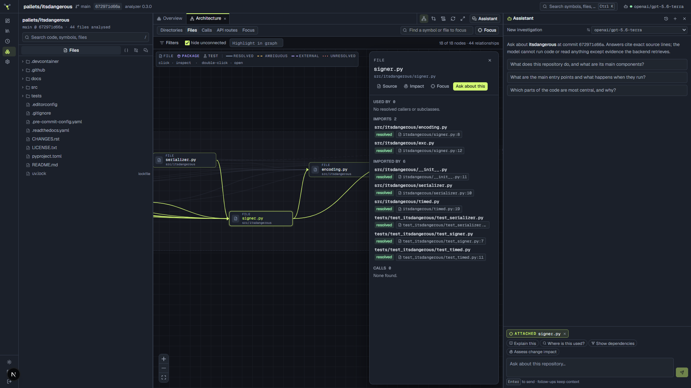

# Ingestion-Pipeline · Code Atlas

*Explore software like a living system.*

Evidence-grounded repository intelligence workbench. Paste a public GitHub repository URL; the system
acquires it safely, analyses it statically (Python, TypeScript/JavaScript, Go, Java), builds a resolved
graph of files, symbols, calls, inheritance and routes, traces possible execution flows, answers
questions through a tool-less AI agent, and shows **every statement with verifiable evidence**
(exact file and line range at an exact commit).

> Status: M0–M7 functional release, ready for owner testing. Not production-ready; designed for a single developer machine.
> See [Known limitations](#known-limitations) and [docs/ROADMAP.md](docs/ROADMAP.md).



## Capabilities

| Area | What it does |
|---|---|
| Ingestion | Strict GitHub URL validation; hardened shallow clone in a Windows Job Object (memory/process limits, kill-on-close); exact commit SHA; atomic snapshots; per-commit cache; incremental re-analysis reusing unchanged files' parse results |
| Analysis | Python (`ast`), TypeScript/JavaScript, Go, Java (Tree-sitter): symbols, imports/re-exports, calls, inheritance with method lookup, override-aware dispatch, declared/constructed/returned local types, attribute types, field initializers; FastAPI, Flask, Django, Express, Next.js, Gin/net-http, Spring routes; pip, npm, Go modules, Maven/Gradle manifests |
| Intelligence | Bounded execution-flow tracing; "where is this used?" (direct vs transitive); potential change impact (routes, tests, unresolved references); hybrid deterministic retrieval; snapshot comparison |
| Evidence | Versioned contract (1.1), stable IDs, verification against disk, claim basis computed by the backend |
| AI | OpenCode stateless generation without tools; backend read-only evidence gateway; multi-turn Q&A pinned to one commit; validated reports |
| UI | Code Atlas identity (docs/DESIGN_DIRECTION.md). One workspace: repository explorer (search, files, symbols, entry points, investigations), a tabbed canvas (overview, source, symbol usage/dependencies/impact, architecture, execution flows, report, compare) and a persistent AI assistant beside the code with contextual actions; real analysis stages; light/dark; keyboard and mouse |
| Ops | Separate worker process with timeouts/cancellation/recovery; local token auth with HttpOnly sessions; PowerShell scripts; CI on Linux + Windows incl. Playwright |

## Quick start (Windows 11, PowerShell)

Prerequisites: Python 3.12+, Node.js 20.9+, Git. OpenCode is optional (AI features only).

```powershell
.\scripts\setup.ps1           # installs uv if needed, syncs backend, npm ci
.\scripts\start-dev.ps1      # backend (API + worker + private OpenCode) and frontend, each in its own window
# or separately:
.\scripts\start-backend.ps1   # API on http://127.0.0.1:8000
.\scripts\start-frontend.ps1  # UI on http://localhost:3000
```

On first start the backend writes an API token to `backend\data\api-token` (readable only by your Windows
user). Open http://localhost:3000, paste it once; the browser then uses an HttpOnly session cookie.

```powershell
.\scripts\health.ps1          # backend, worker, auth, OpenCode, frontend
.\scripts\test.ps1            # lint, types, tests, build   (-E2E for Playwright, -Bench, -Live)
```

## Documentation

- [ARCHITECTURE.md](ARCHITECTURE.md) — components, data flow, worker model
- [docs/SECURITY.md](docs/SECURITY.md) — threat model, auth, isolation, residual risks
- [docs/EVIDENCE_CONTRACT.md](docs/EVIDENCE_CONTRACT.md) — evidence and claim semantics
- [docs/OPENCODE_INTEGRATION.md](docs/OPENCODE_INTEGRATION.md) — runtime, model, Q&A protocol
- [docs/BENCHMARKS.md](docs/BENCHMARKS.md) — development and held-out ground-truth benchmarks, real-repo regression
- [docs/EVALUATION.md](docs/EVALUATION.md) — semantic-correctness evaluation (automatic triage vs human review)
- [docs/TESTING.md](docs/TESTING.md) — test strategy and latest results
- [docs/WINDOWS_SETUP.md](docs/WINDOWS_SETUP.md) — environment setup
- [docs/DESIGN_DIRECTION.md](docs/DESIGN_DIRECTION.md) — Code Atlas art direction and interaction principles
- [docs/TROUBLESHOOTING.md](docs/TROUBLESHOOTING.md) — "backend is not running" and other recovery steps
- [docs/DECISIONS.md](docs/DECISIONS.md) — decision log
- [docs/ROADMAP.md](docs/ROADMAP.md) — what is done and what is not
- [docs/screenshots/](docs/screenshots/) — UI screenshots captured from a real instance

## Known limitations

- Call resolution is static: generics, chained calls, reflection, decorators' runtime effects and runtime wiring
  are not modelled (return types are followed one hop); such call sites are counted, not guessed. Flow steps are
  *possible* paths.
- Impact is static reachability ("potentially affected"), not proof of breakage.
- AI answers cite verified locations; semantic accuracy is measured only by human review (docs/EVALUATION.md).
- Child-process isolation enforces resource limits, not a security sandbox (see SECURITY.md).
- Single machine: SQLite, local token auth, localhost-only binding.
