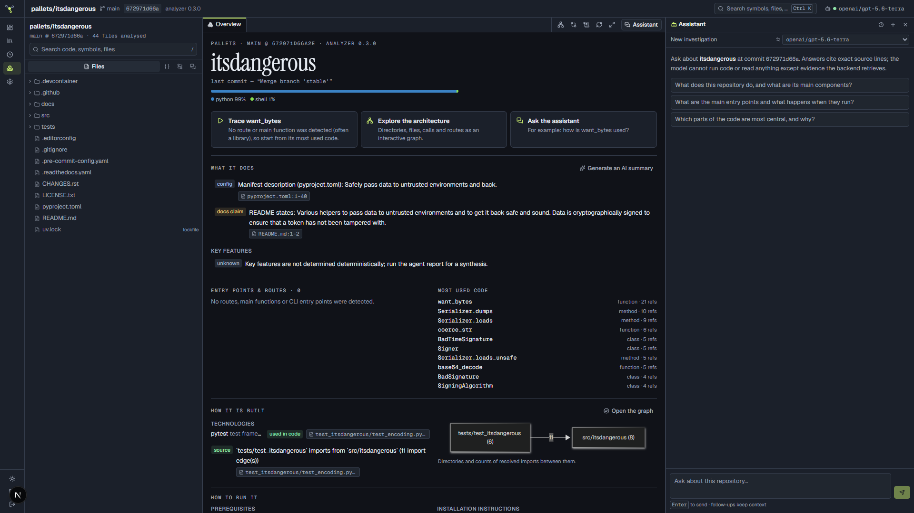
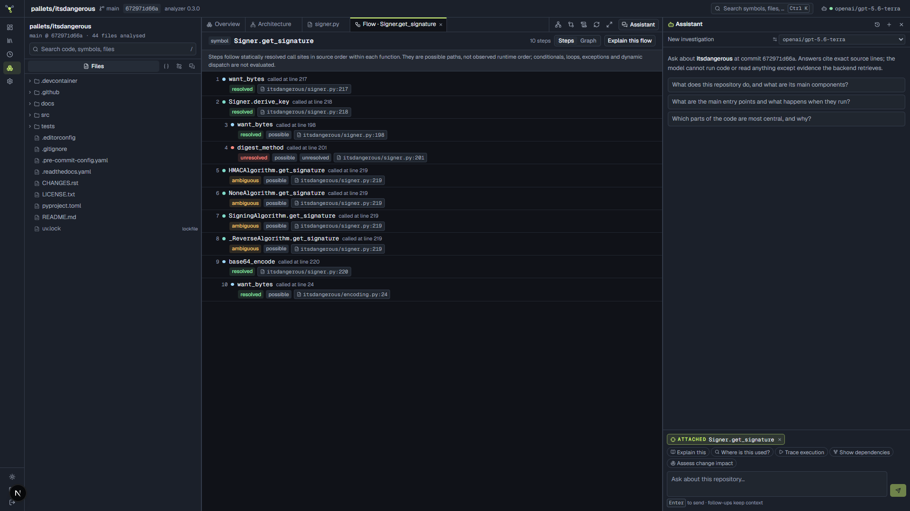
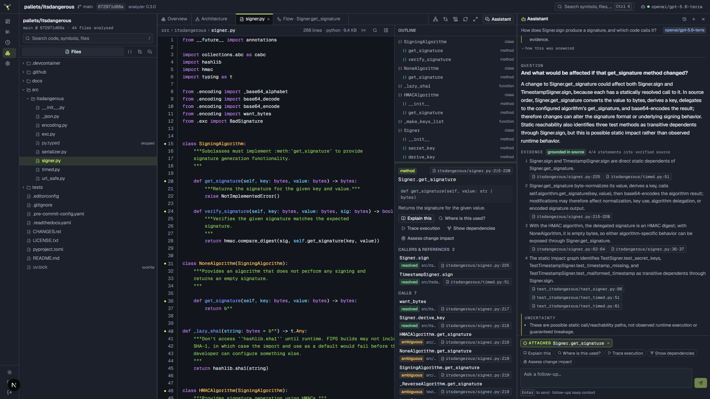
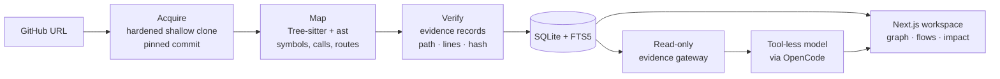

<div align="center">


# Code Atlas

**Explore software like a living system.**

Paste a GitHub URL. Get a map of the codebase — files, symbols, calls, routes and execution flows —
and an assistant that answers questions **with citations to the exact lines, at the exact commit.**

[](https://github.com/SparshSunilNaik/Ingestion-Pipeline/actions/workflows/ci.yml)
&nbsp;
[**Website**](https://sparshsunilnaik.github.io/Ingestion-Pipeline/) ·
[Quick start](#quick-start) ·
[How it works](#how-it-works) ·
[Benchmarks](docs/BENCHMARKS.md)


</div>

## Why

Opening an unfamiliar repository usually means an afternoon of grepping, guessing which function calls
which, and hoping the README is still true. AI assistants help, until they confidently describe code that
doesn't exist.

Code Atlas takes the opposite stance: **nothing is stated without evidence.** Every fact it knows is a
record pointing at a file, a line range, a commit and a hash of those exact lines. The assistant can only
answer from those records, and anything it can't back up is marked as unsupported instead of quietly
passed off as true.

## What you get

🗺️ **A living architecture graph.** Directories, files and call graphs laid out with ELK, with
collapsible groups. Select a node and its relationships light up; open its source and come back to exactly
the same view.

🔀 **Execution flows.** Pick a route or an entry point and trace the possible paths through the code,
step by step, each step linked to its source.

💥 **Change impact.** "What breaks if I touch this?" — the routes, tests and callers that could be
affected, direct vs transitive, with the unresolved references counted rather than guessed.

💬 **Answers with citations.** Ask in plain English. Each claim is tagged with its basis —
`source`, `config`, `docs claim` or `unsupported` — and links to the lines that support it.

🔁 **Snapshot comparison.** Re-analyse after a new commit and see what changed in the structure, not
just in the diff. Unchanged files are reused, so refreshes are fast.

| Overview | Execution flow | Assistant |
|---|---|---|
|  |  |  |

## Languages and frameworks

| | |
|---|---|
| **Languages** | Python (`ast`), TypeScript / JavaScript, Go, Java (Tree-sitter) |
| **Routes** | FastAPI, Flask, Django, Express, Next.js, Gin, net/http, Spring |
| **Manifests** | pip, npm, Go modules, Maven, Gradle |
| **Resolution** | imports and re-exports, inheritance with method lookup, override-aware dispatch, constructor and attribute types, one-hop return types |

## Does it actually work?

Measured against hand-written ground truth, including a **held-out fixture written before the analyzer
ever ran on it** and never tuned against:

| | Development fixture | Held-out fixture |
|---|---|---|
| Symbol precision / recall | 1.000 / 1.000 | 1.000 / 1.000 |
| Relationship precision / recall | 1.000 / 1.000 | 1.000 / 1.000 (24/24) |
| Evidence citations valid | 104 / 104 | 91 / 91 |
| Route recall | 4 / 4 | 5 / 5 |

On a real repository ([pallets/itsdangerous](https://github.com/pallets/itsdangerous)), all **574 evidence
records re-verify against disk** with zero rejected. The held-out fixture's first run scored 23/24; the
miss was reproduced in the development fixture and fixed there, and the held-out fixture then scored 24/24
without being edited. Full numbers and methodology: [docs/BENCHMARKS.md](docs/BENCHMARKS.md).

The project ships with 230+ automated tests (backend unit, security and integration, Vitest and
Playwright), run in CI on Ubuntu and Windows.

## Quick start

Windows 11 with PowerShell, Python 3.12+, Node.js 20.9+ and Git. [OpenCode](https://opencode.ai) is
optional — without it, all static analysis still works; only the assistant is disabled.

```powershell
git clone https://github.com/SparshSunilNaik/Ingestion-Pipeline.git; cd Ingestion-Pipeline
.\scripts\setup.ps1       # installs uv if needed, syncs the backend, npm ci
.\scripts\start-dev.ps1   # backend, worker and frontend, each in its own window
```

Open http://localhost:3000 and paste the token from `backend\data\api-token` once; the browser keeps an
HttpOnly session after that.

```powershell
.\scripts\health.ps1      # check backend, worker, auth, OpenCode and frontend
.\scripts\stop-dev.ps1    # stop the project's servers (and only those)
.\scripts\test.ps1        # lint, types, tests and build  (-E2E for Playwright)
```

Something not starting? See [docs/TROUBLESHOOTING.md](docs/TROUBLESHOOTING.md).

## How it works



1. **Acquire safely.** A shallow clone of the exact commit — no hooks, submodules or LFS — inside a
   Windows Job Object with memory and process limits. Snapshots are swapped in atomically; a failed run
   never touches the previous one.
2. **Map statically.** Source is parsed into symbols, imports, calls, inheritance, routes and
   dependencies, then resolved across files into a graph.
3. **Verify evidence.** Every fact becomes a record checked against the snapshot on disk.
4. **Explore and ask.** The model never gets tools, a shell or the repository. It sees only the evidence
   the backend chooses to hand it, and the backend — not the model — decides each claim's basis.

**Stack:** FastAPI · SQLite (WAL + FTS5) · Tree-sitter · NetworkX · Next.js 16 · ELK · OpenCode.
Deeper dive: [ARCHITECTURE.md](ARCHITECTURE.md).

## Security model

Repository code is **analysed, never executed.** Everything binds to localhost, the API needs a local
token, and the AI path is read-only by construction. The isolation enforces resource limits; it is not a
security sandbox, and [docs/SECURITY.md](docs/SECURITY.md) spells out the threat model and residual risks.

## Honest limitations

- Call resolution is static. Generics, chained calls, reflection and runtime wiring aren't modelled;
  those call sites are counted, not guessed. Flows are *possible* paths.
- Impact is static reachability — "potentially affected", not proof of breakage.
- Citations are verified automatically; whether an answer is *semantically* right is checked by human
  review ([docs/EVALUATION.md](docs/EVALUATION.md)).
- Built for one developer machine on Windows: SQLite, local auth, localhost only. Not production-ready.

## Documentation

| | |
|---|---|
| [ARCHITECTURE.md](ARCHITECTURE.md) | Components, data flow, worker model |
| [docs/EVIDENCE_CONTRACT.md](docs/EVIDENCE_CONTRACT.md) | What an evidence record is and how claims are graded |
| [docs/SECURITY.md](docs/SECURITY.md) | Threat model, auth, isolation, residual risks |
| [docs/BENCHMARKS.md](docs/BENCHMARKS.md) | Ground-truth benchmarks and real-repo regression |
| [docs/OPENCODE_INTEGRATION.md](docs/OPENCODE_INTEGRATION.md) | Model runtime and Q&A protocol |
| [docs/DESIGN_DIRECTION.md](docs/DESIGN_DIRECTION.md) | The Code Atlas visual identity |
| [docs/WINDOWS_SETUP.md](docs/WINDOWS_SETUP.md) · [docs/TROUBLESHOOTING.md](docs/TROUBLESHOOTING.md) | Setup and recovery |
| [docs/ROADMAP.md](docs/ROADMAP.md) | What's done and what's next |
